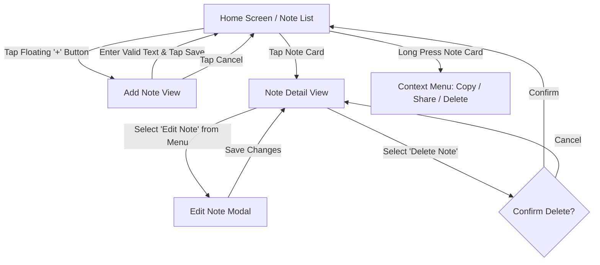

# NoteFlow 📝

A production-ready, beautifully designed iOS Notes application built with **SwiftUI** and modern iOS architecture. NoteFlow is built from first principles with an original editorial card design, responsive layout, local persistence via `UserDefaults` and `Codable`, zero external dependencies, robust accessibility, and seamless Light/Dark mode support.

---

## 📸 Screenshots

| Home Dashboard | Add / Edit Note | Note Detail View | Dark Mode |
| :---: | :---: | :---: | :---: |
|  |  |  |  |

---

## ✨ Features

- **Original Editorial Design**: High-contrast typography, category badges, dynamic accent indicators, and clean card hierarchy without copying generic notes apps.
- **Live Search & Filtering**: Real-time, case-insensitive note search paired with horizontal category chips (**All**, **Study**, **Work**, **Ideas**, **Personal**).
- **Responsive Layout**: Designed iPhone-first with full adaptive layout across iPhone SE, standard iPhones, iPhone Pro Max, and iPad in both portrait and landscape orientations.
- **Full Offline Persistence**: Automatic JSON serialization with `UserDefaults` ensuring notes persist across app terminations and restarts.
- **CRUD Operations**:
  - **Create**: Character-limited composer (up to 2,000 chars) with live counter and whitespace validation.
  - **Read**: Dedicated reader view with creation and modification timestamps, word counts, and text selection.
  - **Update**: In-place editing preserving original creation dates and UUIDs.
  - **Delete**: Safe deletion protected by alert confirmations and context menus.
- **Light & Dark Mode**: Dynamic semantic styling using Apple's adaptive system colors (`Color.primary`, `Color(.secondarySystemBackground)`).
- **Comprehensive Accessibility (A11y)**: Dynamic Type support, high-contrast tap targets (>44pt), VoiceOver labels, and descriptive accessibility hints.
- **Zero External Dependencies**: Pure native SwiftUI without third-party frameworks, Firebase, or external pods.

---

## 🔄 App Flow



1. **Home → Add Note → Save → Home**: Creating a new note inserts it at the top and navigates back to the dashboard.
2. **Home → Detail → Edit → Save → Detail**: Updating note text or category updates `updatedAt` and refreshes the detail view.
3. **Home → Detail → Delete → Home**: Deletion prompts for confirmation and gracefully pops back to the dashboard.

---

## 🏛️ Architecture & Folder Structure

NoteFlow follows a clean, decoupled **MVVM (Model-View-ViewModel)** architecture:

```text
NoteFlow/
├── App/
│   └── NoteFlowApp.swift             # App entry point with SwiftUI WindowGroup
│
├── Models/
│   └── Note.swift                    # Identifiable, Codable, Equatable Note entity
│
├── ViewModels/
│   └── NoteStore.swift               # ObservableObject single source of truth & persistence
│
├── Views/
│   ├── Home/
│   │   └── ContentView.swift         # Main dashboard with search, filters & cards
│   ├── AddNote/
│   │   └── AddNoteView.swift         # Reusable creation & editing sheet with validation
│   ├── Detail/
│   │   └── NoteDetailView.swift      # Editorial reader screen with options menu
│   └── Components/
│       ├── NoteCard.swift            # Custom editorial card component with context menu
│       ├── SearchBar.swift           # Accessible search input with clear action
│       ├── EmptyStateView.swift      # Dual-mode empty state (no notes vs no search results)
│       ├── CategoryChip.swift        # Filter chip with live note count badge
│       └── FloatingAddButton.swift   # Circular action button with tactile spring feedback
│
├── Utilities/
│   ├── DateHelper.swift              # DateFormatter utilities for relative & full dates
│   └── Constants.swift               # Constants, limits, palettes, and storage keys
│
├── .gitignore                        # Comprehensive iOS Git ignore rules
└── README.md                         # Developer documentation & setup guide
```

---

## 💾 Local Storage & Error Handling

- **Persistence Layer**: `NoteStore` encodes and decodes `[Note]` using `JSONEncoder` and `JSONDecoder` directly to `UserDefaults`.
- **First-Launch Seed**: Populates 5 distinct, realistic sample notes covering Computer Networks, SwiftUI Architecture, Study Plans, App Ideas, and Weekend Tasks. Sample notes are only loaded once on the very first launch.
- **Fail-Safe Decoding**: If JSON decoding encounters corrupted data, errors are logged via `print()` and the app gracefully falls back to sample data or an empty state without crashing.

---

## 🎨 UI/UX & Micro-Interactions

- **Tactile Feedback**: Spring animations on button presses, category selection, and card scale on press.
- **Live Character Counter**: Dynamic character counter indicating remaining space up to 2,000 characters.
- **Validation State**: Empty note validation provides immediate visual cues and disables the save action.
- **Two Distinct Empty States**: Clear distinction between an empty library vs. an active search yielding no results.

---

## 📋 Requirements

- **iOS 16.0+**
- **Xcode 15.0+**
- **Swift 5.9+**

---

## 🚀 Installation & Setup

1. **Clone or Download** the project:
   ```bash
   git clone https://github.com/<your-username>/NoteFlow.git
   ```
2. **Open Xcode**:
   - Launch Xcode.
   - Choose **Create a new Xcode project** → **App** (iOS).
   - Set **Product Name** to `NoteFlow`.
   - Set **Interface** to `SwiftUI` and **Language** to `Swift`.
3. **Import Project Files**:
   - Drag and drop the `NoteFlow` folder contents into your Xcode project navigator.
   - Ensure **"Copy items if needed"** and your app target are checked.
4. **Run the Project**:
   - Select an iPhone Simulator (e.g., iPhone 15 Pro, iPhone SE 3rd gen) or a physical device.
   - Press `Cmd + R` to build and run.

---

## 📌 Assumptions

- Notes are short-to-medium text documents (capped at 2,000 characters per note for optimal performance and card layout).
- `UserDefaults` provides sufficient performance and throughput for local note storage.
- Notes are stored entirely on-device; no remote cloud synchronization or backend servers are required.

---

## 🔮 Future Roadmap

- [ ] CloudKit synchronization across Apple devices
- [ ] Folder hierarchies and nested sub-notebooks
- [ ] Rich Markdown formatting with syntax highlighting
- [ ] Biometric lock (Face ID / Touch ID) for private notes
- [ ] Image and audio attachments
- [ ] Scheduled reminders and notifications
